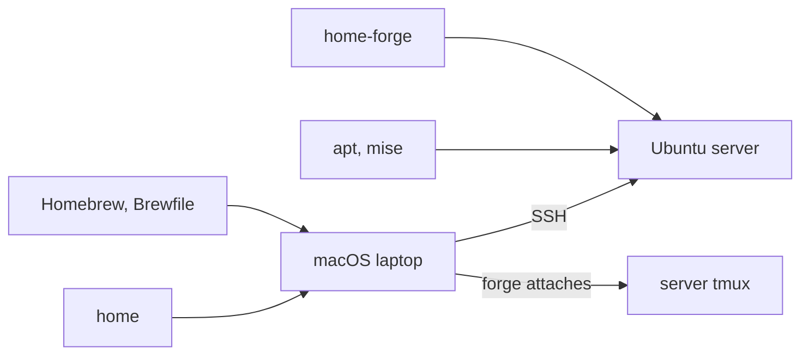
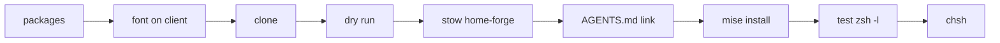
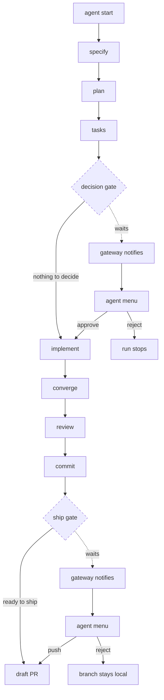

# :floppy_disk: dotfiles

The diagram shows the two stow packages, the machine each one targets, where
their tools come from, and how the laptop reaches the server.



Two [stow](https://www.gnu.org/software/stow/) packages, one per machine:

| Package      | Machine                         | Tools come from        |
|--------------|---------------------------------|------------------------|
| `home`       | macOS laptop                    | Homebrew (`Brewfile`)  |
| `home-forge` | headless Ubuntu server, via SSH | apt + mise             |

Stow links each file of a package into `$HOME`, so a dotfile is changed in the
repository, never in `$HOME`: `~/.zshrc` is a link to the copy in the package.

## What installs itself

Nothing to do for these, they install themselves on first launch:

| Piece                          | Installed by                                         | When                    |
|--------------------------------|------------------------------------------------------|-------------------------|
| Powerlevel10k (server), fzf-tab | `.zshrc`, cloned into `~/.local/share`              | the first shell         |
| TPM and the tmux plugins       | `.tmux.conf`, which clones TPM and installs the plugins | the first tmux start |
| lazy.nvim                      | lazy.nvim bootstraps itself                          | the first `nvim`        |
| treesitter parsers             | nvim-treesitter builds them — that takes the `tree-sitter` CLI and a C compiler | the first `nvim` |

## macOS laptop

Eight steps: install Homebrew, clone the repository, install the tools, check
the links with a dry run, link the dotfiles, install the runtimes, import the
iTerm2 profile, apply the macOS settings.


### 1. Install Homebrew

Install Homebrew from https://brew.sh/

### 2. Clone the repository

```shell
git clone https://github.com/XabAyca/dotfiles ~/.dotfiles
cd ~/.dotfiles
```

### 3. Install the tools

Install the CLI tools, apps and fonts:

```shell
brew bundle
```

### 4. Check the links (dry run)

```shell
stow -n -v --no-folding home          # dry run, writes nothing
```

### 5. Link the dotfiles

```shell
stow --no-folding home
```

<details><summary>Files already in place</summary>

A `~/.zshrc` or `~/.gitconfig` already in place would block stow: move it aside,
then run the step again.

</details>

### 6. Install the runtimes

```shell
rbenv install <version> && rbenv global <version>
pyenv install <version> && pyenv global <version>
nodenv install <version> && nodenv global <version>
rustup default stable
```

<details><summary>Versions</summary>

`<version>` stands for the version each project needs; pick it per runtime.

</details>

### 7. Import the iTerm2 profile

iTerm2: Settings > Settings > Import, and pick `iTerm2_State.itermexport`.

### 8. Apply the macOS settings

```shell
source install-macos-settings.sh
```

## Ubuntu server

`home-forge` patches the paths for Linux and configures tmux to survive SSH
disconnects without leaking the remote clipboard. Verified on Ubuntu 26.04.

Prerequisite: [mise](https://mise.jdx.dev), which manages the runtimes and tools
(node, rust, claude, neovim, tree-sitter, …) listed in `~/.config/mise/config.toml`.

Nine steps: install the packages, install the font on the machine you connect
from, clone the repository, check the links with a dry run, link the dotfiles,
point `AGENTS.md` at the constitution, install the runtimes, test in a child
zsh, make zsh the login shell.



### 1. Install the packages

```shell
sudo apt update
sudo apt install -y stow zsh build-essential fd-find bat lsd git-delta \
  zsh-autosuggestions zsh-syntax-highlighting
sudo locale-gen fr_FR.UTF-8 && sudo update-locale
```

<details><summary>Already installed</summary>

`git`, `tmux`, `fzf` and `ripgrep` are often already installed.

</details>

### 2. Install the font — on the machine you connect **from**

Install [MesloLGS NF](https://github.com/romkatv/powerlevel10k#manual-font-installation)
and select it in the terminal.

<details><summary>Why on the client</summary>

Glyphs are drawn by the client, so nothing installed on the server can fix missing
ones. `.p10k.zsh` runs in `nerdfont-complete` mode — a Nerd Fonts v3 face renders
shifted glyphs rather than none.

</details>

### 3. Clone the repository

```shell
git clone https://github.com/XabAyca/dotfiles ~/projects/dotfiles/main
cd ~/projects/dotfiles/main
```

<details><summary>Shell setup only</summary>

`~/projects/dotfiles/main` is where the agent tooling expects the repository. A
machine that only wants the shell setup can clone it under `$HOME` instead:

```shell
git clone https://github.com/XabAyca/dotfiles ~/.dotfiles
cd ~/.dotfiles
```

</details>

### 4. Check the links (dry run)

```shell
stow -n -v --no-folding -t ~ home-forge          # dry run, writes nothing
```

<details><summary>Why <code>-t ~</code></summary>

Add `-t ~` when the repository lives anywhere other than directly under `$HOME`.
A `~/.zshrc` or `~/.gitconfig` already in place would block stow; step 5 removes
them. From a clone in `~/.dotfiles` the commands go without it:

```shell
stow -n -v --no-folding home-forge          # dry run, writes nothing
stow --no-folding home-forge
```

</details>

### 5. Link the dotfiles

> [!WARNING]
> This removes `~/.zshrc` and `~/.gitconfig`: that is what lets stow link. A
> `~/.zshrc` or `~/.gitconfig` already in place would block stow. Both are
> copied to `.bak` first.

```shell
cp -n ~/.zshrc ~/.zshrc.bak 2>/dev/null; cp -n ~/.gitconfig ~/.gitconfig.bak 2>/dev/null
rm -f ~/.zshrc ~/.gitconfig
stow --no-folding -t ~ home-forge
```

Check: `ls -l ~/.zshrc ~/.gitconfig` shows both as links into the repository.
Roll back: `stow -D --no-folding -t ~ home-forge`, then move `~/.zshrc.bak` and
`~/.gitconfig.bak` back.

<details><summary>Tools the package ships</summary>

The package also ships `fd` and `bat` (Debian names them `fdfind` and `batcat`)
and `emojify`, which `.gitconfig` pipes git's output through to render gitmoji.

</details>

### 6. Point AGENTS.md at the constitution

```shell
ln -sfn .claude/CLAUDE.md ~/AGENTS.md
```

<details><summary>Why</summary>

`~/.claude/CLAUDE.md` ships with the package: the baseline rules every agent reads,
in every project. Claude Code picks it up on its own; other agents look for
`AGENTS.md`, so point one at it.

</details>

### 7. Install the runtimes

```shell
mise install
```

### 8. Test in a child zsh

Keep **two** SSH sessions open and, in one of them, run `zsh -l` — a child process
you leave with `exit`, never `source ~/.zshrc`, which asks bash to read zsh.

```shell
zsh -l
```

<details><summary>What to check</summary>

Check the p10k prompt and its glyphs, `node -v`, `cargo -V` and `which claude` (the
mise test), `git diff` rendered by delta, `git log` with its gitmoji,
`Ctrl-T` / `Ctrl-R` / `Alt-C`, `cd <Tab>`, `ll`, `nvim`, and `C-hjkl` across tmux
panes and nvim splits.

</details>

### 9. Make zsh the login shell

> [!WARNING]
> Every new SSH connection starts this shell. Only once step 8 is reliable,
> several sessions in a row.

```shell
chsh -s "$(which zsh)"
```

Check: open a **new** SSH connection and confirm it reaches the prompt before
closing the others.
Roll back: from a live session, `chsh -s /bin/bash`.

### Agent tooling

`home-forge` also ships the tooling that runs a feature from its description to
a draft pull request, with a person stepping in at two gates.

#### What each part is for

- `agent` starts and drives runs, each in a detached tmux session on its own worktree.
- The feature workflow (`agents/feature/workflow.yml`) is what a run executes.
- The gateway (`agents/gateway/gateway`) says when a run waits, fails or ends.
- `record` keeps what each run cost and decided.
- `retro` reads the records every Monday and proposes workflow changes; it only proposes.
- The Claude skills `design-ui`, `review-feature` and `review-ui` are the UI design
  and review steps the workflow calls.
- `forge`, on the laptop, lists the worktrees on the server and attaches to their
  tmux session.

#### Life of a run

A run waits for a person at two gates: the decision gate before the code and the
ship gate before the push. Each pause sends a gateway notification, and
`agent menu` answers it. A gate with nothing to decide, or a run ready to ship,
goes straight on. A `reject` at the decision gate stops the run; at the ship
gate it leaves the branch on the machine.



#### Before a first run

- `jq`: `sudo apt install -y jq`
- Spec Kit's [`specify` CLI](https://github.com/github/spec-kit)
- `gh auth login`: `agent start` itself calls `gh`, and the pull request needs it
- the project cloned as `~/projects/<project>/main`, with an `origin` remote and
  Spec Kit's `.specify/`

#### Set it up

1. Make the gateway configuration, then edit it:

    ```shell
    cd ~/projects/dotfiles/main/home-forge/agents/gateway && cp -n config.env.example config.env
    ```

    <details><summary>Channels, and why this path</summary>

    `AGENT_GATEWAY_CHANNEL=file`, the default, needs no account: it appends to
    `~/.local/state/agent-gateway/inbox.md`, no network. `slack` also needs
    `SLACK_BOT_TOKEN` and `SLACK_CONVERSATION`, the two values the example names.

    The gateway reads the `config.env` next to its resolved script, in the
    repository: stow links files one by one, so one copied into `~/agents/gateway/`
    is never read. Git ignores it, since it names a workspace.

    </details>

2. Enable the two timers, the gateway every minute and the retro on Mondays:

    ```shell
    systemctl --user daemon-reload
    systemctl --user enable --now agent-gateway.timer agent-retro.timer
    ```

3. Check: `systemctl --user list-timers 'agent-*'` lists both timers. Then send a
   test message and read it in the inbox:

    ```shell
    systemctl --user list-timers 'agent-*'
    ~/agents/gateway/gateway say test
    tail ~/.local/state/agent-gateway/inbox.md
    ```

#### Every day

| Command                                       | Purpose                                      |
|-----------------------------------------------|----------------------------------------------|
| `agent start <project> "<feature>"`           | start a run on a new worktree                |
| `agent list`                                  | the runs and where each one stands           |
| `agent menu`                                  | pick a run, then answer its gate             |
| `agent stop <project>/<branch>`               | stop a run, resumable                        |
| `agent done <project>/<branch>`               | record the run, then remove its worktree     |
| `forge` (on the laptop)                       | attach to a run's tmux session               |
| `record log`                                  | the last runs, newest first                  |
| `retro`                                       | propose workflow changes from the records    |
| `bat ~/.local/state/agent-gateway/inbox.md`   | read the `file` channel's notifications      |

`answer`, `resume`, `retry` and `preview` complete the list; `agent` without
arguments prints them all.

#### Do not change it during a run

No change to `home-forge/agents/` (the workflow and its scripts) or
`home-forge/.claude/skills/` while `agent list` shows a run running or paused.
Editing this README stays safe: no run reads it.

## Tests

The scripts of `home-forge` carry their own — no framework, no network. This
covers the agent scripts too:

```shell
find home-forge -name '*.test.sh' | while read -r t; do echo "== $t"; bash "$t" || break; done
```

## Optional

- `zdiff3` instead of `diff3` for `merge.conflictstyle`, and `syntax-theme = gruvbox-dark`
  under `[delta]` — check the name against `delta --list-syntax-themes` first.
